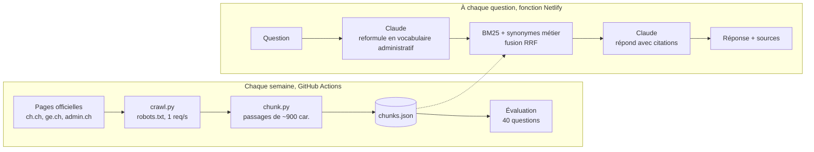

# Nouveau en Suisse ? Un assistant RAG pour les démarches

Quand on arrive en Suisse, ou qu'on y travaille comme frontalier, les questions s'enchaînent : où s'annoncer, quand s'assurer, comment fonctionne l'impôt à la source, faut-il échanger son permis de conduire... Les réponses existent, mais elles sont dispersées entre la Confédération, les cantons et les offices.

Cet assistant répond à ces questions **uniquement à partir des pages officielles** (ch.ch, ge.ch, SEM, OFSP), et **cite chaque source**.

**Démo : https://assistant-suisse.netlify.app**

> *EN : A retrieval-augmented assistant for newcomers and cross-border workers in Switzerland. It answers only from official government pages, cites every source, and its retrieval quality is measured on a set of real newcomer questions.*

[](https://github.com/Toumil94/assistant-rag-suisse/actions/workflows/ci.yml)
[](https://github.com/Toumil94/assistant-rag-suisse/actions/workflows/ingest.yml)

## Architecture



## Les choix techniques, et pourquoi

| Choix | Pourquoi |
|---|---|
| **Collecte respectueuse** | robots.txt respecté (le site de l'AVS l'interdit, il a donc été exclu), une requête par seconde, agent identifié. |
| **Sources officielles uniquement** | Sur l'administratif, une réponse fausse peut coûter cher (amende, délai manqué). Chaque information doit renvoyer à une page d'autorité. |
| **Recherche lexicale BM25** plutôt qu'un index vectoriel | Le vocabulaire administratif est précis (« permis G », « LAMal », « OCPM ») : la correspondance exacte des termes compte. BM25 tient en mémoire dans une fonction serverless, sans base vectorielle ni coût d'embedding, et chaque résultat est explicable. |
| **Dictionnaire de synonymes métier** | Les gens disent « frontalier » quand la page dit « permis G », ou « caisse maladie » pour « assurance obligatoire des soins ». Le dictionnaire relie ces vocabulaires. |
| **Reformulation par le LLM + fusion RRF** | Claude traduit la question en 2-3 requêtes au vocabulaire officiel. Les classements sont fusionnés par Reciprocal Rank Fusion, robuste et sans paramètre à régler. |
| **Diversité des sources** | Au plus deux passages par page, pour croiser plusieurs sources dans une réponse. |
| **Réponse ancrée et citée** | Le modèle n'a le droit d'utiliser que les passages fournis, doit citer [n] chaque information, et dire quand les sources ne suffisent pas. |
| **Évaluation chiffrée** | Un jeu de 40 questions réelles de nouveaux arrivants mesure si la bonne page est retrouvée, pour comparer les configurations et éviter les régressions. |
| **Coûts maîtrisés** | Modèle Claude léger, réponses plafonnées, 20 questions par heure et par adresse IP. |

## Évaluation de la recherche

Les résultats détaillés, mis à jour à chaque collecte, sont dans [`eval/RESULTS.md`](eval/RESULTS.md).

Les métriques :
- **Bonne page en 1re position (Hit@1)** : part des questions dont le premier passage vient d'une page pertinente.
- **Bonne page dans le top 5 (Recall@5)** : ce que voit le modèle pour répondre.
- **MRR@10** : position moyenne de la première bonne page, en inverse (1 = toujours première).

## Structure

```
ingest/      sources.yaml (sites et règles), crawl.py (collecte), chunk.py (découpage)
netlify/     functions/ask.mjs (API), lib/retriever.mjs (BM25), lib/prompts.mjs, data/chunks.json
eval/        questions.yaml (jeu de test), run.mjs (évaluation), RESULTS.md
site/        interface web
tests/       tests unitaires de la recherche
```

## Lancer en local

```bash
pip install -r requirements.txt
python ingest/crawl.py && python ingest/chunk.py   # ~15 min, une requête par seconde
node eval/run.mjs                                   # évaluation de la recherche
node --test tests/*.test.mjs                        # tests unitaires
npx netlify dev                                     # site + API, avec ANTHROPIC_API_KEY dans l'environnement
```

## Limites

- Informations générales, pas un conseil juridique. Les règles varient selon le canton, la nationalité et le permis.
- Le corpus est centré sur Genève et le niveau fédéral. Les autres cantons ne sont couverts que via ch.ch.
- Les pages sont rafraîchies chaque semaine : un changement très récent peut ne pas être encore pris en compte.

## Auteur

**Lyes Toumi**, Data & AI Engineer à Genève, arrivé en Suisse comme frontalier puis résident : ce sont mes propres questions qui ont donné l'idée. [Portfolio](https://toumilyes.netlify.app) · [LinkedIn](https://www.linkedin.com/in/lyes-toumi/)
